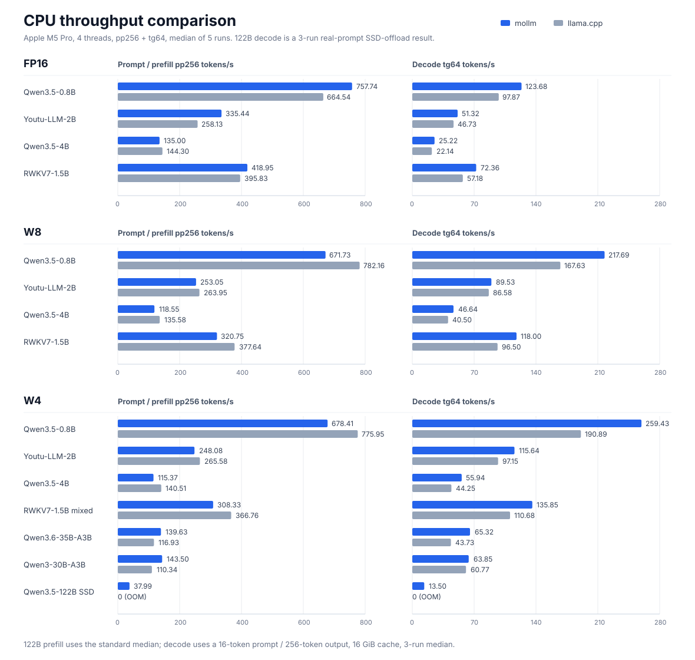
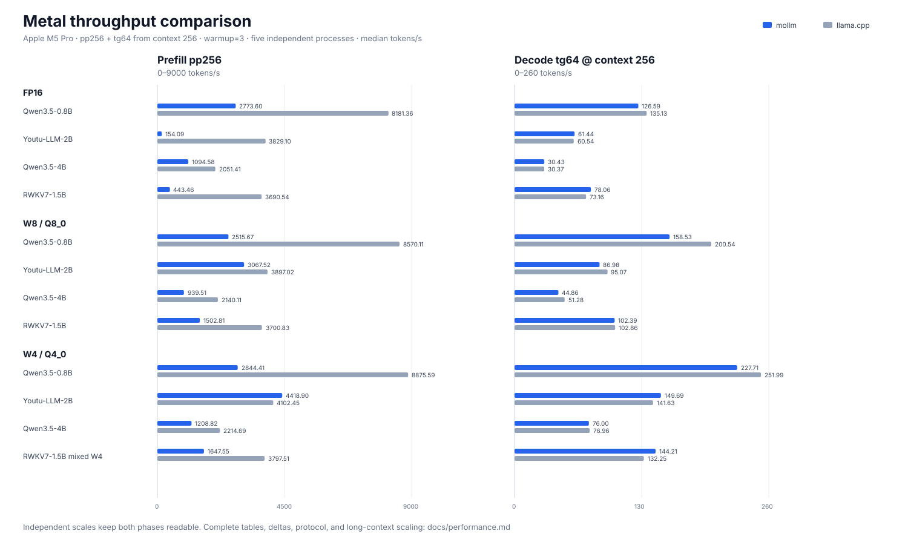

# palm-infra

Palm Team 的 AI Infra 项目，目前包含 `mollm`。完整英文说明见 [README.md](README.md)。

## mollm

mobile-oriented LLM inference engine.
```
                 _ _
 _ __ ___   ___ | | |_ __ ___
| '_ ` _ \ / _ \| | | '_ ` _ \
| | | | | | (_) | | | | | | | |
|_| |_| |_|\___/|_|_|_| |_| |_|
```

`mollm` 是面向 ARM 和 x86 CPU 的轻量 C++ LLM 推理引擎，并提供实验性的 Apple Metal 支持。它将已支持的 Hugging Face 模型目录转换成单个 `.mollm` 文件，其中包含计算图、权重、tokenizer 与对话模板，并可直接运行。

项目当前聚焦 Apple Silicon 和其他现代 ARM 处理器上的高性能本地推理：FP16 使用 NEON FP16FML kernel；CPU 量化模型使用针对 ARM dot-product 指令优化的 weight-only int8/int4 kernel。Linux x86_64 将 scalar、AVX2/FMA/F16C 与 AVX-512 provider 编译为相互隔离的单元，覆盖 FP32、FP16、W8 以及 packed W4G32/W4G128 matmul；启动时通过 CPUID 选择当前 CPU 支持的最宽指令集，旧 CPU 不会执行新指令。设置 `MOLLM_X86_ISA=scalar|avx2|avx512|auto` 可以限制分派层级，便于正确性验证或针对具体机器调优；原有的 `MOLLM_X86_DISABLE_AVX2=1` scalar override 仍然可用。

## 使用 SSD offload 运行大规模 MoE 模型

`mollm` 将稠密权重保留在 RAM 中，只把命中的路由 expert 从 SSD 装入有界的
共享 cache。同一套异步 offload 路径同时支持 W4 模型以及 checkpoint 原生的
FP8/MXFP4 和 NVFP4 expert。

| 模型 | Expert cache | Prefill | Decode |
|---|---:|---:|---:|
| Qwen3.5-122B-A10B W4 | 16 GiB | **51.06 t/s** | **16.53 t/s** |
| Qwen3.8-Flash-Next NVFP4 | 20 GiB | **16.2 t/s** | **21.8 t/s** † |
| DeepSeek-V4-Flash | 16 GiB | **9.52 t/s** | **5.71 t/s** |
| Hy3-295B-A21B W4G128 | 16 GiB | **10.57 t/s** | **3.41 t/s** |

† 真实 prompt 下观察到的最好结果，使用 8 CPU threads 和 20 GiB
expert cache；其他行使用各自注明的 4-thread / 16-GiB 协议。

[Cache sweep、I/O 行为与 tracing](docs/ssd-offload.md) ·
[完整性能表与测试协议](docs/performance.md)

## 已支持的模型

CUDA 内存诊断可设置 `MOLLM_CUDA_PREFILL_REUSE_WORKSPACE=0`，关闭同形状
prefill 的全节点输出保留，在支持的图中使用生命周期释放。含状态算子的图
目前仍延迟到调用结束才清理，该开关只能避免跨调用保留。未设置时保持原行为，
decode/MTP 不变。设备池仍缓存已释放分配：这不是内存上限，也不保证更大
chunk/context 能装下；尚未验证长输入性能收益。
可显式设置 `--cuda-prefill-reclaim`（CLI/bench/PPL，默认关闭）启用保守临时
张量释放，仅支持 CUDA resident+offload-PLE。必须设置
`MOLLM_RESIDENT_EXPERT_ARENA=cuda-device`、`MOLLM_CUDA_HOST_HEADROOM_MB>=24576`，
context≤4096、单次执行≤1024；不符合时拒绝，不回退到 CPU。它不改变 chunk
选择、decode 或权重布局。修复物化 view 链寿命后，完整 Qwen loss 表已与新跑的
chunk256/512 基线、历史 chunk1024 参考一致，具体范围见 `docs/performance.md`。
规划器自身的稳定提速仍未验证；不同 chunk 的 loss 和生成文本不一定相同。
实验参数 `--cuda-prefill-logical-batch` 可单独启用 Qwen3.8 动态整段 prefill
（默认关闭）：要求 reclaim、chunk0..2048（0 默认2048）、输出池1..4096 MiB
及关闭 decode segments；拒绝 MTP/padding/SSD/vision/profile/两窗口调度。
该参数自动启用 read-only last-use；需取消旧 stateful/liveness 序列上限。
重要：当前 Qwen3.8 bring-up 图没有实现 QSA indexer；2048 budget 之外
仍做 dense attention。16K/32K 是运行时容量及诊断范围，不是原模型长上下文
正确性保证。此前长输入 loss/回复一致仅指本实现优化前后，不能替代原模型
QSA 对照。正在优先补齐稀疏选择路径。
上下文容量 `--n-ctx` 与批量大小独立，例如可用 `--n-ctx 16384`
配合 `--prefill-chunk-size 512`。长输入按配置批量追加 KV，短输入不补齐；
2048 是当前支持的单批上限，不是上下文上限。长 KV 不满足 grouped attention
条件时回退到原有算子；内存保护仍生效，长上下文性能需另行测量。
GB10 上可用独立的可选启动脚本简化上述实验配置：
先运行 `cmake --build build_cuda --target mollm_chat -j 2`，然后
运行 `./chat-qwen38-cuda.sh` 进入多轮对话。脚本默认上下文16384、
chunk2048、最多生成512 tokens；例如
`./chat-qwen38-cuda.sh --n-ctx 16384 --prefill-chunk-size 512` 可覆盖批量。
它使用本地 `../qwen38_flash_next_nvfp4_calibrated.mollm`，不读取历史测试脚本，
不会自动编译/下载；启动前要求 GPU 空闲且 MemAvailable 至少100 GiB。
Linux chat/bench 还复用 `MOLLM_CUDA_HOST_HEADROOM_MB` 每250ms检查可用内存；
该 preset 的阈值为24 GiB。低于阈值或无法读取时，只终止模型进程并返回137，
不重置 GPU、不终止父会话。保留 stdin/TTY 和正常信号行为，不新增启动参数。
这是尽力保护，不能保证挡住采样间的瞬时分配；紧急停止前尝试恢复 TTY，
但不执行模型析构。
这是可选的已记录实验 preset，不是所有环境的默认配置；内存检查不是预留。
logical-prefill 现在自动选择兼容的 MoE 输入 half 复用和 token K-major；
启动脚本不再要求 `MOLLM_CUDA_MOE_PREFILL_INPUT_HALF_REUSE=1` 或
`MOLLM_CUDA_NVFP4_PREFILL_TOKEN_CODES_KMAJOR=1`。设为 `0` 仍可分别关闭；
普通 CUDA、decode、CPU/Metal 的默认行为不变，原有形状和布局限制仍保留。
logical-prefill 还自动请求已验证的 MoE 输入 scale K-major、紧凑 logits、
token 共享量化及 pair-word 读取；启动脚本不再强制设置对应的
`MOLLM_CUDA_NVFP4_PREFILL_INPUT_SCALE_KMAJOR`、`COMPACT_LOGITS`、
`TOKEN_QUANTIZE`、`TOKEN_PAIR_WORDS`（后三者同样带前缀
`MOLLM_CUDA_NVFP4_PREFILL_`）。每项仍可显式设为 `0` 关闭；仅在原有
融合、均匀量化尺度、对齐及权重布局条件都满足时选择，作用域外默认不变。
logical-prefill 也自动请求已验证的 prefix、跳过零 PV 和 PV 维度配对；
无需再设置 `MOLLM_CUDA_SDPA_PREFILL_VALIDATED_PREFIX=1`、
`MOLLM_CUDA_SDPA_PREFILL_SKIP_ZERO_PV=1`、`MOLLM_CUDA_SDPA_PREFILL_PV_PAIR=1`。
原有验证及形状限制不变，每个选项仍可显式设为 `0` 关闭；作用域之外默认关闭。
注意：下述长 KV 优化与数值一致性仅针对当前 dense bring-up 诊断图，
不表示完整 QSA 长上下文模型已实现。
该 preset 现在自动选择已验证的长 KV attention PV 路径：保留原 QK/softmax，
仅用 FP32 GEMM 替换 PV，无需额外启动开关或重新转换权重。选择范围为
Qwen3.8 的 H24/KVH2/D256、32..2048 行和兼容布局，KV 容量可到32768。
GB10（SM121）自动支持实际4097..32768 keys；其他架构的自动范围仍为
4097..16384。按实际 keys 选择，不因容量大于16384而回退。
扩展路径已通过约28K完整输入、逐 token loss、512-token 多轮/重置和
算子安全检查；新默认二进制的9项后端、7K/14K/28K loss及多轮回归也通过。约28K输入的同二进制交叉
benchmark prefill 从388.9提升至446.5 t/s（约14.8%），decode基本不变。
这不保证任意容量/批量组合都能放进内存，也不能与7K吞吐直接比较。
短窗口、decode、捕获及不兼容配置仍回退原路径。logical prefill 的 score
缓冲也按实际需要扩容，避免将2.25 GiB需求翻倍到4 GiB。测量和验证范围见
[性能记录](docs/performance.md)。
GB10（SM121）上，符合上述条件且实际 keys<=16384 时还自动采用同 warp 两 query-head
布局，保留原有 QK 累加及 softmax 归约顺序；不增加全局工作区或启动参数。
其他 CUDA 架构及不符合条件的形状保持原路径。
这条长 KV 路径还自动省去 QK 中重复读取已验证的正零 mask，保留正零加法
及原有数值顺序；负零或其他不规范 mask 回退原计算，不跳过验证。
无需新增开关或重转模型。7K/32K 同二进制交替对照的 prefill 约提升3.9%，
7K/14K token loss 和日常长首轮、多轮、重置输出一致；详见性能记录。
SM121 的中等 KV 窗口也自动采用 native QK/softmax + GEMM PV：仅在
已有至少2048 token 历史、实际 keys 为2049..4096、query 为32..2048
且符合上述布局/验证条件时选择。该段仍用单 head 的概率生产布局，
起始短窗口及捕获保持原路径；无需新增启动开关。已验证 chunk1024/2048、
7K/14K 输入和多轮对话；私有 `MOLLM_TEST_CUDA_SDPA_MID_PV_GEMM=0`
可保留旧路径用于 A/B。具体测量和验证范围见性能记录。
上述中等 KV 单-head 路径也自动省去已验证正零 mask 的重复读取，沿用
长窗口的同一策略，不增加独立开关。7K/32K 同二进制交替对照再提升
prefill 约2.1%；7K/14K、chunk1024 和多轮/重置均验证一致。
在 logical-batch 下，已请求的 MoE K-major/紧凑 logits/token 共享量化等优化
也可覆盖短 prefill，不再要求超过1024行；仍需满足原生批处理及模型布局约束，
普通窗口和 decode 不受此策略扩展影响。
每次调用检查主机保护线以上额外4 GiB 余量（不是预留或 OOM 保证）。
各算子仍独立分块，无需重转权重；采用前须验证模型质量和热身后端到端性能。
当前已验证的 1743-token 整批配置还需同时设置
`MOLLM_TEST_CUDA_HC_GATE_ROW_TILE=1024` 和
`MOLLM_TEST_CUDA_HC_LOW_RANK_ROW_TILE=1024`，使两类 HC 投影保持原有数值
分块；只开 logical-batch 不等于 loss 与基线一致。
独立实验开关 `MOLLM_TEST_CUDA_DENSE_WIDE_FULL_LT=1`（默认关闭）允许
1025..2048 行的 N16480/K2560 宽投影使用已筛选的零 workspace Lt 算法。
不适用的形状/算法仍回退；它不改变其他后端或权重布局。不要同时开启
`MOLLM_TEST_CUDA_DENSE_WIDE_ROW_TILE=1024`，后者会优先采用内部行分块。
验证数据、范围及性能记录见 [性能记录](docs/performance.md)。

已有实验开关 `MOLLM_CUDA_SDPA_PREFILL_HEAD_GROUP=4` 也已在 1743-token
整批配置验证：改为四个 query head 共享同一 KV head，不增加工作区。
需同时启用 validated-prefix、skip-zero-PV、query-group4 及 shared-score-limit1024；
仅适用 D256、query16..2048、key1025..4096、GQA 比例为4的倍数。
默认关闭；短窗口、decode、不兼容形状沿用原路径，不改权重格式或其他后端。
当前同配置对照约 +1.15% prefill，loss/token 一致；完整条件和记录见性能文档。

可选参数 `MOLLM_CUDA_OUTPUT_POOL_MB` 限制 CUDA 输出池保留量，单位 MiB，
未设置或设为 0 时关闭。新增分配将超限时，后端先同步工作、使缓存的 CUDA
Graph 失效，再仅释放已归还池的缓存块；活跃缓冲不受影响。仍装不下，或
capture/replay 阻止回收时，分配失败。回收可能增加延迟，暂非提速推荐，
也不是系统级 OOM 保证：权重、scratch、持久存储和驱动分配不在此上限内。
原有主机内存余量检查保持不变。

Linux 统一内存 CUDA 可设置 `MOLLM_CUDA_HOST_HEADROOM_MB`，在显式 CUDA
分配（包括 resident arena 和 scratch 扩容）前检查 MemAvailable，保留指定
MiB 主机余量。未设置或 0 时关闭；配置无效或可用量无法读取时拒绝分配。
这不是内存预留，也不保证免于 OOM，并发分配和驱动额外开销仍需预算。
参数仅接受十进制数字，不接受正负号或空白。scratch 扩容被预算拒绝时直接
返回失败，保留旧缓冲区，不进入 CUDA OOM 重试路径；实际 CUDA 分配失败
仍保留原有 fallback 行为。

实验参数 `MOLLM_CUDA_GR_INJECT_RMS_FUSION=1` 融合 Qwen 门控注入与紧随
其后的分组 RMS，保留两份 FP32 输出。需配合已有 HC prefill 激活复用与
RMS-half 开关；不支持的 shape 使用原路径。默认关闭，profile、trace、节点
dump 和部分执行时禁用。不需要重新转换模型或权重。小图及受限 Qwen
sanity256/engineering512 的完整 token-loss 表已验证一致。857-token、chunk512
正反顺序对照的 prefill 耗时减少约 1.30%/1.00%，12 组完整 32-token 输出
一致，但输出池多占约 184 MiB。其他 shape/模型质量未验证，仍为可选实验，
不改默认配置；测试范围与内存限制见 `docs/performance.md`。

实验开关 `MOLLM_CUDA_HC_PREFILL_DEFERRED_RMS=1` 进一步省去 HC 归一化值的
FP32 写回：投影复用已有 FP16 shadow，GR_REDUCE 用 carry/gamma/逆范数重建。
需同时开启两项融合、HC 激活复用/RMS-half，并禁用 decode segments。严格检查
图输出、消费者及生命周期，不支持的路径保持原样，fallback 读取会重建 FP32。
默认关闭，每个 backend 增加 64 KiB；不需转换权重或增加 expert 副本。
受限 resident+PLE-offload、1743-token/chunk1024 对照的 1742 行 loss 和
12 组完整 32-token 输出一致，正反顺序 prefill 耗时减少 1.77%/1.93%
（约 1090→1110 tok/s）。其他模型/shape 未验证，不改默认配置；安全限制见
`docs/performance.md`。

在上述 deferred-RMS/FP16-shadow 配置下，可选已有开关
`MOLLM_CUDA_PREFILL_FP16_CACHE_HC_DOWN=1`，在同一个 FP16 缓存预算中缓存
97 个 HC down 矩阵（额外 606.25 MiB，不增加 expert 副本、不需转换权重）。
新 1743-token/chunk1024 正反 A/B 的 prefill 耗时减少 0.83%/0.51%
（同配置均值约 1107→1115 tok/s）；1742 行 loss 和 12 组完整 32-token 输出
一致。decode 路径未改；仍默认关闭，仅验证上述受限配置，不是通用性能预设。

实验参数 `MOLLM_TEST_CUDA_WINDOW_DEFER_MOE_INJECT=1`（默认关闭）需要现有
合并 MoE 的 layer-major 窗口调度和 segment fusions。将符合条件的无状态注入
移到下一段，打开已有注入/RMS 融合，状态更新顺序不变。当前受限 1743-token
resident+offload-PLE 配置 ABBA 实测 prefill 1380→1391 TPS（+0.78%），
decode 仍约 35；完整 hidden/state/KV dump 和 12 组 token 序列一致。
验证范围见 `docs/performance.md`。

HC up/reduce 图准备现改为每次准备共享一份结构索引，不再逐候选重建；
无新增开关，不改 GPU 数学或权重布局。当前 1743-token/chunk1024/ctx4096
resident+offload-PLE 同配置 ABBA 实测 prefill 1393.35→1419.81 TPS（+1.90%），
decode 仍约 35；100 条 hidden/state/KV 记录与 12 组完整 token 序列一致。
这是 CPU 图准备优化，并非 GPU kernel 提速；验证范围和基线构建细节见
`docs/performance.md`。

Deferred-HC 准备也改为每张图共享使用者和位置索引，不改算子数学或权重。
同一受限配置 ABBA 实测 prefill 1416.19→1437.83 TPS（+1.53%），100 条状态
记录和 12 组完整 token 序列一致。保留并报告一次 32-token decode 波动；
反向顺序 128-token 跟进的新旧 decode 均为 34.97 TPS，完整输出一致。
这是受限 CPU 规划优化证据，不是全模型/所有负载无回退保证。

可选 HC up/reduce 参数 `MOLLM_CUDA_HC_PREFILL_UP_INPUT_PITCH=336` 和
`MOLLM_CUDA_HC_PREFILL_UP_TILE_COLUMNS=32`，默认仍为 320/16；仅在已有验证
路径中 rows>=256 时使用 columns32。不增加全局 scratch，不需重新转换。
当前受限 1743-token/chunk1024 resident+offload-PLE 配置 ABBA 实测
prefill 1363→1376 TPS（+0.94%），decode 仍约 35 TPS；完整状态 dump 和 token
输出一致。验证范围见 `docs/performance.md`。

可选 `MOLLM_CUDA_NVFP4_PREFILL_INPUT_SCALE_KMAJOR=1`（默认关闭），调整
融合 MoE 合并窗口的输入 scale 布局和量化器工作顺序，仅用于
1024<rows<=2048；小窗口/decode 保留原布局，不增加 scratch/cache，
也不需重新转换。在当前受限 resident+offload-PLE、1743-token、query-group4
及 weight-scale-cache 配置上，ABBA 实测 prefill 1344.4→1359.6 TPS
（+1.13%），decode 仍约 35 TPS；完整 hidden/state/KV dump 和 12 组 token
输出一致。范围与证据见 `docs/performance.md`。

可选 `MOLLM_CUDA_PREFILL_GATE_SCALE_CACHE_MB=<MiB>`（默认 0，最大 8192）
仅控制旧 canonical gate 布局的额外 scale 视图预算。当前聊天预设的 resident
gate-K-major 模式已自动共用一份 K64-major scale，加载、prefill、decode
使用同一份数据，省去约 4.69 GiB 副本；不需要配置该预算，也不需重新转换。
算术顺序保持不变，CPU fallback 会还原原布局，CPU/Metal/SSD 路径不变。
7K/32K、14K/16K loss 和多轮对话验证通过；整模型吞吐没有稳定提升，
不能把这次内存优化当成 prefill 提速。精确对照见 `docs/performance.md`。

可选 `MOLLM_CUDA_NVFP4_PREFILL_COMPACT_LOGITS=1`（默认关闭），将融合 gate/up
中已经按 BF16 舍入的共享 logits 无损存成 16 位代码。需同时启用 gate-scale
视图和 Kmajor input scales，仅选择 1024<rows<=2048、hidden2560/inter640 的
常驻融合合并窗口；decode/回退路径不变，不增加 cache，不需重新转换。
受限 1743-token 同二进制 ABBA 实测 prefill 1483.2→1500.9 TPS（+1.19%），
完整状态 dump 与 12 组完整 128-token 序列一致。没有稳定 decode 收益，
验证范围见 `docs/performance.md`。

可选 `MOLLM_CUDA_NVFP4_PREFILL_TOKEN_QUANTIZE=1`（默认关闭），在上述融合
合并窗口中让 gate/up 共享逐 token 量化。逐层检查所有 expert 的 gate/up
输入校准值是否完全相同；不满足条件就保留原路径，down/decode 不变。
不改权重文件、不需重新转换，暂时保留原 scratch 容量，额外增加 route 索引。
1743-token 同二进制 ABBA prefill 1507.4→1517.3 TPS（+0.65%），完整状态
dump 与 12 组完整 128-token 序列一致；decode 约 35 TPS，无稳定收益。
独立算子收益不能直接外推为整模型收益，精确范围见 `docs/performance.md`。

可选 `MOLLM_CUDA_NVFP4_PREFILL_TOKEN_PAIR_WORDS=1`（默认关闭），需上述
共享 token 量化条件，并限于 pair 布局的常驻 gate；将临时输入代码交错，
每个 MMA 输入片段改为一次 64 位读取。不改权重文件、不增加缓存或 scratch
容量。1743-token 同二进制 ABBA prefill 1517.7→1538.6 TPS（+1.38%）；
256-token 反向复测 +1.30%。状态与完整输出一致。128-token 对照的 decode
略降 0.45%，256-token 复测基本持平（约 34.79 TPS），不承诺所有负载无回退。
精确范围与全部样本见 `docs/performance.md`。

实验开关 `MOLLM_CUDA_NVFP4_N32_ASYNC_WEIGHTS=1` 仅为 canonical CUDA-device
常驻 gate GEMM 启用 CTA 异步权重 staging（hidden2560/inter640、N32、4 warp、
prefill 行数≥16）。compact、native layout 或不支持的配置保持原路径；down/decode
不变。不需重新转换权重，也不增加常驻 expert 副本。kernel replay、边界及
sanitizer 检查通过，受限 sanity256/engineering512 的完整 loss 表一致。
857-token/chunk512（两边都开 GR 融合）正反对照的 prefill 耗时减少约
1.24%/1.02%，12 组完整 32-token 输出一致，输出池保留量未增加。其他负载
尚未证明收益；默认关闭，精确范围和内存保护见性能文档。

| 模型系列 | 状态 |
|---|---|
| Qwen3 dense text models | FP16、W8、W4 |
| Qwen3-30B-A3B MoE | 仅文本 W4 路径 |
| Qwen3.6-35B-A3B MoE | 仅文本 W4 路径 |
| Qwen3.5-122B-A10B MoE | CPU W4，支持 SSD expert offload |
| Qwen3.8-Flash-Next | 仅文本 CPU / 实验性 CUDA 混合推理，支持原生 NVFP4 expert offload |
| Tencent Hy-MT2-30B-A3B | 仅文本 W4 MoE；支持 CPU 与 Metal |
| Tencent Hy3-295B-A21B | 仅文本 W4 MoE，支持 CPU SSD expert offload |
| Qwen3.5-0.8B / Qwen3.5-4B | FP16、W8、W4、混合 W4；实验性单图视觉输入 |
| Youtu-LLM-2B | FP16、W8、W4、混合 W4 |
| RWKV7 | FP16、W8、混合 W4；循环式 CPU prefill/decode |
| DeepSeek-V4-Flash | 实验性纯 CPU 推理，支持原生 FP8/MXFP4 与 SSD expert offload |

当前测试最充分的运行路径是 `w4g128`：它占用内存最少，且具有 mollm 中最快的
decode 速度。所有基于 `config.json` 的 converter 也支持 `w4g32` 和
`w4mixg32`。更小的 group 能改善 W4 质量，代价是更多 scale 和潜在的吞吐下降；
mixed 模式沿用各模型 `w4mixg128` 的 policy，决定哪些敏感 tensor 保留为 W8。

## 性能

### CPU

除非另有说明，Apple M5 Pro 数据使用 4 CPU 线程、`pp256 + tg64`、
`warmup=3` 和独立进程中位数。

当前 W4 中位数在 Youtu-LLM-2B 和 Qwen3.5-4B 上分别达到 140.77 和
69.78 decode tokens/s，是对应 llama.cpp Q4_0 CPU 结果的 1.47 倍和
1.73 倍。W4A8 decode 将激活与权重统一为 128-value 分组，先在整数寄存器
中累计四个 dot-product block，再统一应用 scale。图中的所有 dense 与
recurrent W4 行均使用当前模型包与二进制重新测试。



### Metal（实验性）

Apple M5 Pro Metal 数据采用相同的 `pp256 + tg64`、`warmup=3` 和独立
进程中位数协议。Decode 从已有 256-token 上下文开始，两个运行时都将
模型权重保留在 Metal 上。



[测试协议、完整 CPU/Metal 性能表、长上下文 scaling 与正确性门禁](docs/performance.md)

## 快速开始

```bash
cmake -G Ninja -B build_i8mm -DCMAKE_BUILD_TYPE=Release
cmake --build build_i8mm -j

# W4 转换需要此工具。
cmake --build build_i8mm --target mollm-quantize

# 转换 Hugging Face 模型目录。
python3 models/converter.py /path/to/Qwen3.5-4B qwen35_4b_w4g128.mollm w4g128

# 从单个包文件启动对话。
./build_i8mm/mollm_chat --package qwen35_4b_w4g128.mollm --threads 4
```

交互命令：

```text
/reset   清空对话上下文
/quit    退出
```

## 构建

依赖：

- macOS/Apple Silicon、ARM Linux 或 Linux x86_64
- CMake 与 Ninja 或 Make
- Python 3
- 转换所需的 Python 包，主要是 `numpy` 与 `safetensors`

推荐构建方式：

```bash
cmake -G Ninja -B build_i8mm -DCMAKE_BUILD_TYPE=Release
cmake --build build_i8mm -j
```

在 ARM64 上，支持 i8mm 的编译器会把优化 kernel 作为独立 object 嵌入；运行时通过 HWCAP/sysctl 仅在兼容 CPU 上选用，库的其余部分仍保持 NEON/DOTPROD baseline。`MOLLM_ARM_I8MM=OFF` 会完全移除 i8mm object，`MOLLM_ARM_ISA=neon` 可在测试时强制走 fallback。普通 `build/` 目录也可以使用；将示例中的 `build_i8mm` 替换为对应目录即可。

## 转换模型

转换器会从 `config.json` 自动识别模型类型。

```bash
# 默认 FP16 包。
python3 models/converter.py /path/to/Qwen3.5-4B qwen35_4b_fp16.mollm

# W8 int8 基线。
python3 models/converter.py /path/to/Qwen3.5-4B qwen35_4b_w8pc.mollm w8pc

# W4 性能包。
python3 models/converter.py /path/to/Qwen3.5-4B qwen35_4b_w4g128.mollm w4g128

# 混合 W4 质量包。
python3 models/converter.py /path/to/Qwen3.5-4B qwen35_4b_w4mixg128.mollm w4mixg128

# 更小 group 的纯 W4，以及沿用同一模型 mixed policy 的版本。
python3 models/converter.py /path/to/Qwen3.5-4B qwen35_4b_w4g32.mollm w4g32
python3 models/converter.py /path/to/Qwen3.5-4B qwen35_4b_w4mixg32.mollm w4mixg32

# RWKV7
python3 models/rwkv7.py /path/to/rwkv7-g1h-1.5b.pth rwkv7_1.5b_w4mixg32.mollm --tokenizer /path/to/tokenizer.txt --quant w4mixg32
```

MoE 示例：

```bash
python3 models/converter.py \
    /path/to/Qwen3-30B-A3B \
    qwen3_30b_a3b_w4g128.mollm \
    w4g128
```

DeepSeek-V4-Flash 的实验性转换会保留 checkpoint 原生 FP8 和 MXFP4 权重：

```bash
python3 models/deepseek_v4.py \
    /path/to/DeepSeek-V4-Flash \
    deepseek_v4_flash_native.mollm

./build_i8mm/mollm_chat \
    --package deepseek_v4_flash_native.mollm \
    --ssd-cache-mb 10240 --ssd-io-workers 8 --threads 6
```

Qwen3.8-Flash-Next 转换会保留 checkpoint 的 NVFP4 路由 expert，
将稠密权重离线量化为 W4G32，并将 `lm_head` 保存为 per-channel W8：

```bash
python3 models/converter.py \
    /path/to/Qwen3.8-Flash-Next-NVFP4 \
    qwen38_flash_next_nvfp4.mollm

./build_i8mm/mollm_chat \
    --package qwen38_flash_next_nvfp4.mollm \
    --ssd-cache-mb 16384 --ssd-io-workers 8 --threads 4
```

| `model_type` | 支持的模型 |
|---|---|
| `qwen3` | Qwen3 dense text models |
| `qwen3_moe` | Qwen3 MoE text models |
| `qwen3_5` | Qwen3.5 dense text 与单图视觉模型 |
| `qwen3_5_moe` | Qwen3.5/3.6 MoE text models |
| `qwen4_exp` | Qwen3.8-Flash-Next 文本模型，保留原生 NVFP4 expert |
| `hy_v3` | Tencent HY-V3 / Hy-MT2 MoE text models |
| `youtu` | Youtu-LLM MLA models |
| `deepseek_v4` | 直接使用实验性的 `models/deepseek_v4.py` converter。 |

| 模式 | 适用场景 |
|---|---|
| `fp16` | 最简单的基线，且内存充足。 |
| `w8pc` | 需要 weight-only int8 量化，允许轻微质量偏移。 |
| `w4g128` | 需要最小包大小和最快 decode；通常是性能首选。 |
| `w4mixg128` | 纯 W4 质量不足，可使用更多内存保留部分 W8 tensor。 |
| `w4g32` | 使用更小的 32-value group 改善 W4 质量，并接受更多 scale 和潜在吞吐损失。 |
| `w4mixg32` | 在 W4G32 基础上，沿用该模型 `w4mixg128` 的 W8 tensor promotion policy。 |

DeepSeek-V4-Flash 不使用上述转换量化模式：其中量化的稠密/共享 expert
权重采用 checkpoint 原生 FP8 E4M3 block-128，路由 expert 采用
MXFP4 E2M1/E8M0 group-32。

Qwen3.8-Flash-Next 使用 checkpoint 原生 NVFP4 路由 expert、离线
W4G32 稠密权重和 per-channel W8 `lm_head`。

内存足够容纳全部非 PLE 权重时，可以使用 CPU / CUDA resident 模式的
`--offload-ple`：启动时加载并锁定所有 expert 与稠密权重，只有 PLE
嵌入表通过本地模型包按需分页。Qwen3.8-Flash-Next 的非 PLE 权重约
67.55 GiB，此外还需要运行时缓冲区与 KV cache 空间。

```bash
./build_i8mm/mollm_chat \
    --package qwen38_flash_next_nvfp4.mollm \
    --offload-ple --threads 8 --n-ctx 2048
```

CUDA 构建可额外指定 `--device cuda`；GB10 等支持一致性主机内存访问的
设备可直接用 GPU 计算常驻 NVFP4 expert，无需再复制整套 expert 权重。
常驻专家由长期 lease 保护，路由选择在 GPU 完成；prefill 会按专家聚合
请求，decode 复用 MoE CUDA 子图。PLE 查表在 CPU 按需读取，后续门控和
卷积在 GPU 完成；其他 GPU / 权重布局保留参考回退。稠密权重
会有额外的设备副本，详见 [offload 说明](docs/ssd-offload.md)。
SM121 的长 prefill 默认将 NVFP4 expert 请求排序范围扩展到 4096 条，
改善权重复用；`MOLLM_CUDA_NVFP4_PREFILL_SORT=0` 可回退原排序范围。
这不改变计算精度、decode 路径或磁盘权重布局。收益需要较大的 prefill
图：通用转换入口为此模型默认生成 32-token 图；面向 CUDA 可使用
`models/qwen4_exp.py` 的 `--prefill-seq-len 256`。图块大小属于模型包
元数据，运行参数不会把旧的 32-token 图自动变成 256-token 图。
校准表和实验性 MMA 合批并非此排序优化的必要条件；其测试结果及开关
见 [性能记录](docs/performance.md)。
实验参数 `MOLLM_CUDA_NVFP4_MMA_PREFILL_ONLY=1` 可仅在 prefill 使用
校准后的 FP4 activation MMA，decode 保留 SIMT；它支持现有 resident
row/pair expert 布局，不必启用 native 重排或保留第二份 expert 权重。
模型包需包含 activation 校准表。此模式改变计算精度，尚不默认开启。
可叠加 `MOLLM_CUDA_NVFP4_MMA_PREFILL_BATCH=1`，对长 prefill 的同 expert
路由使用 N8 批量 MMA；canonical 权重同样无需重排。365-token 测试的
prefill 从约 926 ms 降至 776 ms，生成 token 与未合批 MMA 一致；
这不表示与 SIMT 的模型质量等价，也不是所有提示词的性能保证。
合批门槛可用 `MOLLM_CUDA_NVFP4_MMA_GATE_MIN_BATCH` 和
`MOLLM_CUDA_NVFP4_MMA_DOWN_MIN_BATCH` 调整（单个数字 1–8，默认 4/8；
未设置或无效值使用默认）。这些参数只在 MMA 合批开启时生效，
低于门槛的组仍使用原有单输入 MMA，不改变激活量化精度。
可选 `MOLLM_CUDA_NVFP4_MMA_GATE_BATCH_ROUTES=32` 只覆盖合批 prefill 的
gate/up 批宽，down/decode 不变。接受 8/16/32；未设置或无效时沿用共享
批宽。857-token 提示词反序对照的 prefill 缩短约 0.82%，首轮波动较大；
两份同 chunk 固定输入 loss CSV 与 N8 逐字节一致。不用重转权重，
也不代表所有提示词都有稳定收益或与 SIMT 质量等价。
可选 `MOLLM_CUDA_HC_PREFILL_ACTIVATION_REUSE=1` 让配对的 HC prefill
投影共用 FP16 输入转换，保留两次原有 GEMM；默认关闭，要求连续输入且
至少 16 行。857-token 提示词在 chunk=1024 时正反序 prefill 缩短
2.44%–2.49%，没有稳定的总耗时/decode 收益。两份同 chunk 固定输入
loss CSV 逐字节一致，不能推导所有提示词的质量或跨 chunk 等价。
该测试共享工作区容量为 32 MiB，扩容时保留旧缓冲至后端销毁；
不复制 expert、不改权重布局、不用重新转换，其他后端不变。
在上述输入复用开启时，可选 `MOLLM_CUDA_HC_PREFILL_RMS_HALF=1`
让 Group RMS 同时生成 FP16 输入，仍保留原 FP32 输出；默认关闭，
共用原有工作区。相同 857-token/chunk=1024 测试中，额外缩短 prefill
1.28%–1.37%，没有稳定的总耗时/decode 收益；两份同 chunk 固定输入
loss CSV 逐字节一致。不用重转权重，其他后端不变。
可选 `MOLLM_CUDA_NVFP4_ACTIVATION_PREPARE_FUSION=2` 融合 routed
激活与 NVFP4 输入量化，仅用于至少 16 行的合批 MMA prefill；默认关闭。
down 合批门槛为 1 或开启 singleton 预量化时才省掉 FP32 中间写入，
否则保留 FP32 回退缓冲。值 1 始终保留该缓冲，未观察到稳定模型收益。
值 2 在一个 857-token/chunk=1024 提示词的正反序测试中缩短 prefill
0.97%–1.15%；四组同 chunk 固定输入 loss（含两种回退配置）逐字节一致。
decode、其他后端和权重布局不变，不用重新转换，也不是广泛质量保证。
可选 `MOLLM_CUDA_NVFP4_PREFILL_BF16_DOWN_OUTPUT=1` 在 combine 原有的
BF16 舍入边界把 routed down 输出存为 16 位编码；默认关闭。
仅 resident canonical NVFP4 合批 prefill，至少 16 行、hidden=2560、
inter=640、N8、合批门槛 1、四个 warp，且未开 compact/specialized down
或 singleton 预量化时启用；其他配置的生产和消费端一起保留 FLOAT。
复用现有工作区，不增加权重缓存，不用重转权重，decode 和其他后端不变。
一个 1743-token、chunk=1024、ctx=4096 提示词的正反序对照中 prefill TPS
提升 2.01%–2.30%（合并约 1113→1137）；1742 个固定历史 token loss
及 12 组完整生成 token ID 逐字节一致。无 decode 提速或广泛质量保证。
可选 `MOLLM_CUDA_NVFP4_PREFILL_BF16_GATE_OUTPUT=1` 同样在激活原有
BF16 舍入边界把 gate/up 存为 16 位编码；默认关闭。仅 resident canonical
NVFP4 prefill、至少 16 行、hidden=2560/inter=640，需开启 async N32 gate、
gate 合批门槛 1、四个 warp，未开 compact/specialized/singleton 预量化，
且激活准备融合参数为 1/2 时启用。生产/消费端一起切换，其他配置保留 FLOAT。
与 BF16 down 输出独立，不增加缓存或工作区，不用重转权重，decode/其他后端不变。
相同 1743-token/chunk=1024/ctx=4096 测试中额外提升 prefill TPS
0.99%–1.20%（合并约 1136→1149），1742 个 loss 和 12 组生成 ID 完全一致。
首个 OFF 测试出现一条驱动内部内存分配警告，未见应用失败、Xid 或系统 OOM-kill；
原因及测速影响未确认，详见性能记录，不宣称广泛质量或驱动日志完全无异常。
可选 `MOLLM_CUDA_NVFP4_PREFILL_EARLY_INPUTS=1` 将 gate 输入片段加载
提前到异步权重等待前；默认关闭，仅在上述 BF16 async N32 gate 生效且
resident gate 全部为 paired 布局时启用。其他配置回退，不增加缓存/工作区，
无需重转权重，decode/其他后端不变。同一 1743-token/chunk1024/ctx4096
测试中 prefill TPS 额外提升 0.49%–0.63%（合并约 1171→1178）；1742 个
固定历史 loss 和 12 组完整生成 ID 一致，不代表广泛质量或 decode 收益。
可选 `MOLLM_CUDA_PREFILL_LT_GEMM=1` 针对 SM121 上 K2560、N13312/16480、
M512..1024 的 FP16→FP32 prefill 大矩阵缓存 cuBLASLt 候选计划；默认关闭。
按当前库返回的属性选择零工作区、split1 算法；不支持的类型/形状/对齐、
没有合适候选或捕获图中首次遇到的形状均回退。decode/严格 FP32 路径不变，
不改权重布局、不增加权重缓存、无需重转。相同 1743-token/chunk1024/ctx4096
正反序测试额外提升 prefill TPS 0.42%–0.47%（合并约 1177→1182）；1742 个
固定历史 loss 和 12 组完整生成 ID 一致，不是广泛质量或 decode 提速保证。
可选 `MOLLM_CUDA_NVFP4_PREFILL_PARALLEL_PLAN=1` 用 warp ballot 并行生成
稀疏 batch-plan 元数据；默认关闭。仅 canonical resident 合批 prefill，
未开 compact/specialized/singleton 准备时生效。MMA、量化、累计与 BF16 边界
均不改，不增加工作区或权重缓存，不用重转权重，decode/其他后端不变。
同一 1743-token/chunk1024/ctx4096 正反序测试额外提升 prefill TPS
1.55%–1.66%（合并约 1184→1203），1742 个固定历史 loss、12 组生成 ID
一致；不是广泛质量或 decode 提速保证，不建议据此提高 chunk/context。
可选 `MOLLM_CUDA_NVFP4_PREFILL_VECTOR_QUANTIZE=1` 向量化 gate 输入量化；
默认关闭，仅支持的 resident BF16 async gate prefill（16..4096 行）生效，
需开启 BF16 gate selector。每线程缓存16个输入，对齐时 float4 读取、
32-bit packed 写出，未对齐时标量搬运；顺序最大值、FP8/FP4 计算不变。
不增加权重缓存或工作区，不改权重布局、不用重转，普通 decode 不变。
同一1743-token/chunk1024/ctx4096测试 prefill 提升1.85%–1.86%
（合并1202.66→1224.96 TPS），1742个loss、12组生成ID一致。
只支持该测试范围的结论，不是广泛质量保证，也不建议据此提高chunk。
可选 `MOLLM_CUDA_SDPA_PREFILL_VALIDATED_PREFIX=1` 在 GPU 验证显式因果
mask 和 Q/K 数值范围后，跳过 cached FP16 D256 prefill 的未来位置 QK；
验证失败仍计算完整 QK，softmax/PV 顺序不变。默认关闭；一个
857-token/chunk=1024 提示词正反序测试中 prefill 缩短 1.36%–2.70%，
没有稳定的总耗时/decode 收益。两组固定历史 loss CSV 逐字节一致，
不是广泛质量保证。不用重转权重，decode、其他后端和权重格式不变。
开启 validated-prefix 时，可选实验参数
`MOLLM_CUDA_SDPA_PREFILL_SKIP_ZERO_PV=1` 在额外验证 V 有限后，省掉未来
位置的零权重 PV 项；部分结果为零或次正规数时仍执行原有尾部 FMA，
验证失败保留完整计算。默认关闭。一个 857-token/chunk=1024 提示词的
正反序测试中，相比只开启 validated-prefix，prefill 缩短 2.73%–2.80%。
一个 1743-token/chunk=2048 测试中，正反序 prefill 缩短 8.20%–8.26%，
生成 128 token 的总耗时缩短 2.80%–2.81%。
四组固定历史 loss 对照逐字节一致，包含长输入的全局/共享 score 路径；
不是广泛质量/decode 保证，不用重新转换权重。
同时开启 validated-prefix 和 zero-PV 时，可选实验参数
`MOLLM_CUDA_SDPA_PREFILL_PV_UNROLL=1` 只在全局 score 路径
（key 数超过当前共享 score 阈值）展开有序 PV 累加循环。默认关闭，
共享 score 路径和 decode 不变。GB10 的 resident+PLE-offload 模式下，
一个 1743-token/chunk=2048 提示词的正反序测试中，prefill 缩短
1.35%–1.50%，生成 128 token 的总耗时缩短 0.17%–0.65%。
两组长输入同 chunk（1024/2048）loss 对照逐字节一致；sanity256
未命中新路径的 loss CSV 与原参考一致。不是广泛质量/decode 保证，
不用重转权重，也不改变默认 chunk。
同一长提示词在 chunk=1024 下的正反序 prefill 缩短 1.31%–1.40%，
但总耗时方向不一致，不能宣称稳定的总延迟收益。
实验开关 `MOLLM_CUDA_SDPA_PREFILL_PV_PAIR=1` 使用 half2 同时读取
相邻两个 V 维度，各自保持有序 FP32 FMA 累加。必须同时开启
validated-prefix 和 zero-PV，默认关闭；与 PV-unroll 同开时优先使用
配对路径。只影响 D256 缓存 prefill 的全局 score 路径（key 数超过
当前共享 score 阈值），共享 score 路径和 decode 不变。初版共享路径
整模型试验虽输出一致，但没有复现稳定吞吐收益，因此不接入该范围。
long1743/chunk1024 的全部 1742 个固定历史 loss 与参考逐字节一致。
resident+PLE-offload 的同一 long1743/chunk1024 正反序对照中，prefill
缩短 2.03%–2.25%，生成 32 个 greedy token 的总耗时缩短 1.03%–1.56%，
基线为已有的全局 PV-unroll4。12 次完整生成结果一致，没有稳定 decode
收益，也不是广泛质量保证。
不用重转权重，不改变 chunk。
开启 validated-prefix 时，可选
`MOLLM_CUDA_SDPA_PREFILL_SHARED_SCORE_LIMIT=4096` 将共享 score 存储阈值
从默认 1024 个 key 扩大。一个 1743-token/chunk=2048 测试中 prefill
缩短 0.76%–1.05%，没有稳定的总耗时/decode 收益；两种同 chunk
固定历史 loss 对照逐字节一致，不是广泛质量保证。全局工作区仍保留。
开启 zero-PV 和四列 GDN 后，同一长提示词的正反序测试中，阈值 4096
反而让 prefill 慢 1.01%–1.08%；这套已测组合继续用 1024。
独立 attention 算子的收益没有转化为整模型收益。
可选 `MOLLM_CUDA_GDN_PREFILL_PAIRED_VALUES=1` 让 GDN 每个 warp 处理两列
独立 value 状态，复用 Q/K 读取，保持每列原有算术顺序；默认关闭。
仅用于至少 16 token 且状态对齐的 prefill；decode、短/串行 prefill 和
butterfly-key 模式保留原路径。一个 857-token/chunk=1024 提示词的正反序
测试中 prefill 缩短 1.12%–1.43%，没有可靠的总耗时/decode 收益。
三组固定历史 loss 对照逐字节一致，包含 1743-token 输入；不是广泛质量保证。
不额外分配内存，不改权重格式，也不用重新转换。
可选 `MOLLM_CUDA_GDN_PREFILL_QUAD_VALUES=1` 让每个 warp 处理四列独立
value，保持每列算术顺序；默认关闭。仅用于至少 16 token、状态按 16 字节
对齐且非 butterfly-key 的 prepared prefill；满足条件时优先于两列模式，
否则沿用已有回退选择。decode 和快照路径不变。
以已开启两列模式为对照，一个 857-token/chunk=1024 提示词的正反序
测试中 prefill 缩短 1.89%–1.90%，总耗时仅缩短 0.18%–0.25%，
不是普遍的 decode 加速。12 次生成输出一致，三组完整固定历史 loss
对照（364/856/1742 个目标 token）逐字节一致；不是广泛质量保证。
不额外分配内存，不改权重格式，也不用重新转换。
1743-token/chunk=2048 提示词的正反序测试也复现收益：prefill 缩短
3.01%–3.05%，总耗时缩短 0.88%–1.00%，12 次完整生成输出一致；
这不代表 decode 加速。
可选 `MOLLM_CUDA_PREFILL_FP16_CACHE_MB=<MiB>` 为宽 Q4 dense 投影保存
展开后的 FP16 权重，减少 prefill 重复解量化；默认 0（关闭），上限
32768 MiB。达到容量上限的权重继续使用原有临时工作区。此项额外占用
内存，不缓存或复制 MoE expert，decode 仍使用原量化权重。
在当前 BF16 gate/down 中间输出及 deferred RMS 组合下，以 prefill 为优先
时可再启用已有的 `MOLLM_CUDA_PREFILL_FP16_CACHE_NARROW=1`，将 48 个
2560×6144 dense 矩阵纳入同一个 8 GiB 缓存预算；额外约 1.40625 GiB，
实际 FP16 缓存合计约 6.23 GiB，不复制 expert、不改模型包，不用重转权重。
1743-token/chunk=1024/ctx=4096 正反序对照中 prefill TPS 提升
1.25%–1.37%（合并约 1154→1169），1742 个 loss 和 12 组生成 ID 完全一致。
这次 decode 差异约 ±0.1%、方向不一致，但较早配置曾略慢；仍默认关闭，
属于内存换 TTFT 的可选取舍，不是广泛质量或普遍性能保证。
可选 `MOLLM_CUDA_SIGMOID_GR_REDUCE_FUSION=1` 融合相邻、单消费者的
HC gate sigmoid 和 stream reduction，避免中间 gate 张量的分配与读写；
默认关闭。仅用于 CUDA 多 token prefill，decode、调试/profiling、提前停止
和其他后端保留原路径，不改变模型包、权重布局或计算精度。
857-token 提示词的正反顺序对照中 prefill 缩短 3.45%–4.35%，12 次生成
输出一致；另一个 364-target 固定历史 CE 对照逐位置 CSV 字节一致。
这不是所有提示词、长度或质量的保证，详见性能记录。
同一提示词使用 chunk=256 时收益较小，prefill 缩短 1.24%–1.40%；
两 chunk 的 364-target CE 对照也字节一致。
可选 `MOLLM_CUDA_SHORTCONV_TRANSPOSE=1` 用小块共享内存转置，使 CUDA
prefill short convolution 的输出写入连续；仅用于 feature stride 为 1 的
输入，默认关闭，decode 和 history-prefix 快照仍走原路径。
857-token 提示词在 chunk=1024 下 prefill 缩短 0.74%–0.81%，生成 token
一致，但总耗时没有稳定收益；另一组两 chunk、364-target 的固定历史 loss
CSV 字节一致。不改变权重布局，不需要重新转换。
可用 `mollm_ppl --decode-after-prefill 256` 评测 prefill 后切换 decode
的逐 token 损失；该评测选项不能与 `--decode-token-by-token` 同时使用。
`--offload-ple` 不改变默认加载方式，不与 `--mmap`、`--ssd-cache-mb` 或 Metal
设备同时使用。它会增加启动时间，但生成时所有 expert 都已常驻内存。
若内存或系统锁页额度不足，加载会报错；`--no-load-warmup` 和
`--no-lock-dense-weights` 不会取消此模式的常驻保证。

实验性 MTP 可通过 `--mtp-companion <本地目录> --mtp-draft-tokens <1..16>`
加载独立 draft bundle，共享主模型 embedding/head，不需重转主模型权重。
bundle 可由 `tools/export_qwen4_mtp_weights.py` 导出。此路径目前仅用于验证：
真实文本短测接受率可达 81.5%，但速度尚未超过串行，不能默认启用；
draft 深度需按实际 prompt 对照，不能以零 token smoke 推断接受率，详见
[MTP 测试与限制](docs/performance.md)。PLE 查表仍在 CPU 上执行，
因此不能将该实际模型路径称为全图 native-only CUDA。
`MOLLM_CUDA_Q4_SMALL_BATCH=1` 可实验性地加速 2–8 token 的大 W4 验证投影，
省去完整 FP16 展开；它使用 FP32 activation，尚未完成模型质量评测，默认关闭。
一致性对照使用 `MOLLM_CUDA_Q4_SMALL_BATCH_EXACT=1`、
`MOLLM_CUDA_GDN_SMALL_BATCH_SERIAL=1` 和 `MOLLM_CUDA_SDPA_SMALL_BATCH_EXACT=1`。
在此基础上，`MOLLM_CUDA_Q4_SMALL_BATCH_EXACT_REUSE=1` 可实验性复用 W4 权重，
只选择与解码归约顺序一致的形状，其余仍逐 token 计算。短 fixture 已验证
hidden/logits 逐位一致，但不代表完整质量评测；这些开关均默认关闭，
目前 MTP 仍比普通串行解码慢，不能作为推荐运行方式。
`MOLLM_CUDA_Q4_COMPACT_BATCH_REUSE=1` 在 exact 与 exact-reuse 开关同时开启时，
另行试验 compact W4 的短批权重复用（N13312/16480、K2560）；不新增原始权重副本，
不改变模型文件。24 组短批 fixture 的逐位输出和 graph 重放检查已通过；
depth4 三次实测中文 35.29→37.38、代码 36.30→38.66 token/s，输出不变。
两组仍慢于普通 decode，不能据此推荐开启 MTP。
`MOLLM_CUDA_MTP_VERIFY_Q8_BATCH=1` 可再试验贪心验证的设备端 Q8 批量
LM-head/argmax（2–8 token）。局部内核保持串行 GEMV 的逐位结果，
中文 MTP 三次均值 37.51→41.34、代码 38.57→41.11 token/s；
代码开启组第一轮偏慢，仍计入均值。两组输出及接受率不变。
新增接口和 CUDA 回归已通过；同长度对照结果见性能文档，
不能据此宣称 MTP 普遍更快。该开关默认关闭，不改变采样路径或模型文件。
`MOLLM_CUDA_MTP_STATE_PREFIXES=1` 可另行试验拒绝草稿后的 recurrent 前缀恢复，
完整保存 GDN、短卷积、PLE n-gram 与 PLE 卷积历史；缺少任一状态仍回退重放。
中文 depth4、32-token 三次实测 41.43→46.09 token/s，重放 5→0 token，
代码反向顺序对照 42.88→47.19 token/s，两组完整输出与接受率不变。
128-token 长测中普通 decode 中文/代码为 41.08/41.20 token/s，
depth4 MTP 为 29.65/39.00 token/s；两组完整输出均一致，但接受率下降，
短测收益不能外推。状态池实际保留约 675.42 MiB（包含原 checkpoint 与空闲缓存），
其中前缀状态的峰值有效载荷约 562.85 MiB。它需要额外缓冲和写流量，
默认关闭；不改变模型文件，也不影响未启用 MTP 的运行。
`MOLLM_CUDA_MTP_DEVICE_CHECKPOINT=1` 可另行试验设备内 recurrent 状态快照，
每份临时快照约 118 MB，每轮释放后由缓冲池复用；depth4 日志中的约 944 MB
是多次 checkpoint 的累计复制量，不是池占用。它不复制模型权重；带主机元数据或不支持的
状态集合仍走原主机路径。该开关默认关闭，普通非 MTP 解码不受影响。

普通 CUDA resident 解码可试验 `MOLLM_CUDA_MOE_SHARED_OVERLAP=1`：
将兼容 W4 布局的单 token shared expert 与 routed experts 重叠执行，
输入就绪及最终合并由显式事件同步，支持 CUDA Graph 捕获。
其他精度、批量 prefill 和非 resident 路径保持原调度；不开启时不创建额外流。
不复制权重、不改变包格式，默认关闭，测量结果见 [性能文档](docs/performance.md)。

`MOLLM_CUDA_Q4_NARROW_PIPELINE=1` 可试验窄 W4 投影的寄存器预读流水：
只覆盖已测的 N2560/K6144、N320/K10240、N640/K2560 单 token 形状，
保留原 FP32 累加/归约顺序，其他布局及批量路径不变。
默认关闭，不改变权重或包格式，无需重新转换；可与 shared-expert 重叠开关组合。
现有 grouped-narrow 和显式 narrow-prefetch 选择保留优先级，实测见性能文档。

`MOLLM_CUDA_NVFP4_SIMT_PIPELINE=1` 可试验 resident NVFP4 单 token 解码的寄存器预读流水：
提前读取下一组权重、块尺度和输入，保留原 FP32 累加及归约顺序。
只覆盖规范 row/pair 布局；MMA、批量 prefill、其他后端保持原路径。
默认关闭，不改变权重布局或包格式，无需重新转换；实测见性能文档。

`MOLLM_CUDA_HC_PROJECTION_PAIR=1` 可试验 HC 主投影和 injection 投影的合并启动：
只匹配共享输入的 N320＋N4/K10240、单 token、规范 W4 BG32 布局。
injection 结果先写入每对独立的 16 字节暂存槽，到原节点再复制至正常输出，
不提前占用后续可复用内存。执行轮次和图缓存签名保证不会误用上轮结果。
默认关闭；批量、多种私有布局和其他后端保持原路径，不改变权重，无需转换。
整模型对照及未保留的输出别名实验见 [性能文档](docs/performance.md)。

`MOLLM_CUDA_Q4_COMPACT=1` 可试验无损的 GPU 私有 W4 scale 压缩：
目前仅选择 N16480/K2560 的 BG32 矩阵，逐个校验 scale 可精确还原后才上传，
否则回退原布局。GPU 只保留一个权重副本，prefill 也能直接使用；
模型文件、CPU/其他后端布局不变，无需重新转换，默认关闭。
GB10 上，与上面四项开关组合的 resident + offload-PLE 短测约 41 token/s，
比同配置关闭 compact 快约 1.4–1.5%；两种提示各三轮的 token IDs 与对照一致。
这不是默认配置的性能，也不代表其他上下文或硬件的收益。
复现已测组合（不启用 MTP，寄存器路由保持关闭）：

```bash
env MOLLM_RESIDENT_EXPERT_ARENA=cuda-device \
    MOLLM_CUDA_MOE_SHARED_OVERLAP=1 \
    MOLLM_CUDA_Q4_NARROW_PIPELINE=1 \
    MOLLM_CUDA_HC_PROJECTION_PAIR=1 \
    MOLLM_CUDA_NVFP4_SIMT_PIPELINE=1 \
    MOLLM_CUDA_Q4_COMPACT=1 MOLLM_CUDA_REGISTER_ROUTES=0 \
    ./build_cuda/mollm_bench --package ../qwen38_flash_next_nvfp4_calibrated.mollm \
    --device cuda --offload-ple --threads 8 --n-ctx 512 --temperature 0 \
    --max-new-tokens 128 --warmup 1 --repeat 3 --print-token-ids \
    --prompt '请用中文简要解释为什么矩阵乘法适合在 GPU 上并行执行。'
```

在上述组合上可另加 `MOLLM_CUDA_GROUP_RMS_CACHE=1`：仅优化单 token、
4 组、每组 2560 维的 group RMS norm，暂存输入并保留原归约顺序。
默认关闭，其他形状和 prefill 不变，不改权重，无需转换。
本轮同构建两种提示各三次对照约提升 0.81% / 1.18%，输出 token IDs 一致；
仍约 41 token/s，微测试的约 19% 收益不能当作整模型收益。

另有独立实验开关 `MOLLM_CUDA_Q4_COMPACT_13312=1`，仅无损压缩
N13312/K2560，并使用整数 scale 还原；N16480 的路径不变。
默认关闭，GPU 不保留额外原布局副本，不改模型文件，无需转换。
与上面六项开关组合的本轮 A/B：中文 41.02→41.54 token/s（+1.27%），
代码 41.16→41.14（基本持平），两组各三轮 token IDs 一致。
不能据此声称所有提示都提速；详细数据见 [性能文档](docs/performance.md)。

另可试默认关闭的 `MOLLM_CUDA_GDN_REGISTER_STATE=1`：仅单 token GDN
decode 用寄存器暂存 recurrent state，prefill 和 prefix snapshot 路径不变。
不改 state 或模型文件布局，无需转换，不增加权重副本。与上述七项组合，
中文正反顺序对照约 +0.67% / +0.38%，代码约 +0.92%，各组三次完整
128-token 输出一致；这只是两个短提示上的小幅收益，不代表长上下文或
其他 GPU 都提速。详细复测与 profile 见 [性能文档](docs/performance.md)。

W4 转换需要 C++ 构建的 `mollm-quantize` 工具；FP16 和 W8 不需要。prefill
图内部以 256 token 为分块大小，但 CPU runtime 使用 dynamic prefill；除非
显式指定 `--static-padded`，短 prompt 不会 padding 到 256。

## 运行对话

```bash
./build_i8mm/mollm_chat --package qwen35_4b_w4g128.mollm --threads 4
```

一次性、确定性的 smoke test：

```bash
./build_i8mm/mollm_chat \
    --package qwen35_4b_w4g128.mollm \
    --prompt "请只输出一句话，不要解释：杭州有什么特点？" \
    --max-new-tokens 64 \
    --threads 4 \
    --temperature 0
```

实验性的 Qwen3.5 单图对话（macOS，CPU vision encoder）：

```bash
./build_i8mm/mollm_chat \
    --package qwen35_0.8b_w4g128.mollm \
    --image photo.png \
    --prompt "描述一下这张图片。" \
    --max-new-tokens 128
```

converter 会将 checkpoint 的 FP16 vision tower 与量化后的文本模型一起写入
`.mollm` 包。当前首版支持 single-shot chat 中的一张静态图片；暂未支持多图、
视频、server 接口及 Metal vision encoder。图片默认按 262,144 像素预算缩放
（约 512x512）；可用 `--image-max-pixels` 在速度和细节间调整，最高
1,048,576 像素。如果不需要视觉能力，转换时可传 `--text-only`，避免 vision
tower 带来的包体与常驻内存开销。

采样生成：

```bash
./build_i8mm/mollm_chat \
    --package qwen35_4b_w4g128.mollm \
    --temperature 0.8 --top-p 0.95 --top-k 40 --min-p 0.05 \
    --repeat-penalty 1.05 --repeat-last-n 128 --seed 42
```

同时支持 OpenAI 风格的 `--presence-penalty` 与
`--frequency-penalty`。参数范围和默认值可通过 `mollm_chat --help` 查看。

默认情况下，`mollm_chat` 以 resident 模式加载包内权重。若需 mmap A/B 测试，传入 `--mmap`；默认 mmap 页面 warmup 已启用，可搭配 `--no-load-warmup` 关闭。

## 基准测试

```bash
./build_i8mm/mollm_bench \
    --package qwen35_4b_w4g128.mollm \
    --prompt-tokens 256 \
    --max-new-tokens 64 \
    --warmup 3 \
    --threads 4
```

## 本地 HTTP 服务

```bash
./build_i8mm/mollm_server \
    --package qwen35_4b_w4g128.mollm \
    --host 127.0.0.1 --port 8080 --threads 4
```

初始 server 提供 `GET /v1/models` 和 OpenAI 兼容的 `POST /v1/chat/completions`（含 SSE streaming）。它在串行请求间保留一个精确 token-prefix KV cache。每个请求均可指定采样参数；默认仍为确定性的 `temperature=0`。详见 [SERVER.md](SERVER.md) 的字段、示例与限制。

## 项目结构

```text
Palm-Infra/
├── core/       Tensor、量化布局与跨后端算子参数
├── runtime/    Backend 接口、线程池、主机计算接口与缓冲池
├── storage/    mmap、文件区间与 SSD expert 缓存
├── graph/      计算图格式、序列化与执行器
├── engine/     LLMEngine、模型加载、tokenizer 与生成流程
├── backends/   CPU、CUDA、Metal 的资源管理与算子调度
├── kernels/    按 cpu/、cuda/、metal/ 划分的数值实现
├── models/     Python 转换器与计算图构建器
├── examples/   CLI、服务端和性能评估程序
├── tools/      独立开发工具
├── tests/      单元、后端与端到端测试
└── cmake/      安装包与下游项目构建支持
```

## 路线图

- 优化 prefill 性能，特别是 W8/W4 稠密模型的 prompt 处理。
- 提升实验性 Metal 性能，重点是量化 prefill、MoE prefill 与 CPU/GPU 同步开销。
- 基于当前单用户 REPL cache，为 serving 工作负载实现完整的 prefix cache。
- 扩展 accelerator 覆盖范围，同时保持 CPU runtime 作为可移植基线。
- 增加更多模型系列，并将当前 Qwen3.5 单图路径扩展到多图、视频、serving 与
  Metal vision encoder。
- 为 DeepSeek-V4 支持投机解码，先实现原生 MTP，并探索
  [DSpark](https://arxiv.org/abs/2607.05147) 风格的 confidence-scheduled
  semi-autoregressive drafting。
- 继续优化 SSD offload。

## 许可证

Copyright 2026 Tencent。根据 Apache License 2.0 发布；详见 [LICENSE](LICENSE) 与 [NOTICE](NOTICE)。捆绑依赖的声明见 [THIRD_PARTY_NOTICES.md](THIRD_PARTY_NOTICES.md)。

## 致谢

- [Cider](https://github.com/Mininglamp-AI/cider)：其在 Apple Silicon 上使用 Metal 4 INT8 TensorOps 实现 W8A8/W4A8 推理的工作，为 mollm 实验性的量化 Metal 路径提供了启发。
- Fang 等人的 [Fate](https://arxiv.org/abs/2502.12224)：其跨层 gate 预测思路为 mollm 实验性的 expert 预取路径提供了启发。
