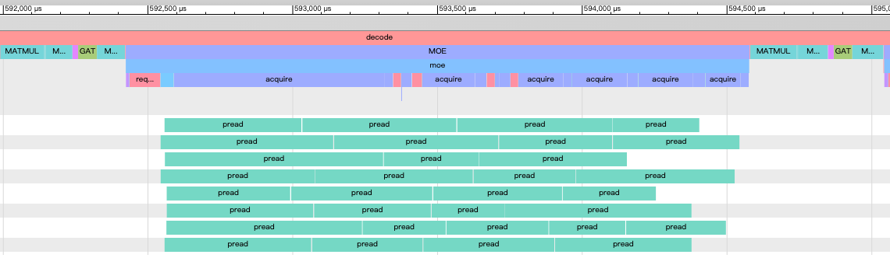

# Running Large MoE models with SSD offload

mollm runs Qwen3.5-122B-A10B, Qwen3.8-Flash-Next, DeepSeek-V4-Flash, and
Hy3-295B-A21B on a 48GB Apple Silicon Mac without keeping the complete model
resident. Always-used dense weights stay locked in RAM, while asynchronous
`pread` workers fetch only the routed MoE expert pairs from the package. A
bounded RAM cache, configured with `--ssd-cache-mb`, retains recently used
expert pairs.

## Cache policy

The default uses one shared cache instead of fixed per-layer quotas. Eviction
adapts to cache pressure: when a layer's fair share cannot hold its current
route, entries from layers already executed in this pass are recycled first;
when the route fits, Least-Stale ordering instead preserves cross-token hits.
A next-layer router prediction submits low-priority reads before the following
MoE layer needs them.

On macOS, the expert cache is pinned by default. Without pinning, the VM
compressor may compress cold anonymous expert buffers and later decompress them
inside matmul. This can make a larger cache slower despite a higher hit rate.
Use `--no-lock-expert-cache` when system-memory headroom matters more than stable
decode throughput.

Historical cache-policy isolation run: real chat prompt, four CPU threads, 16 prompt tokens, 128 generated tokens,
`warmup=1`, and five independent process runs:

| 16 GiB cache policy | Decode | Expert-cache hit rate | Avg. SSD reads / generated token |
|---|---:|---:|---:|
| Legacy equal per-layer cache, no prediction | 10.89 t/s | 74.5% | 0.54 GB/token |
| **Shared cache + cross-layer prefetch** | **12.70 t/s** | **89.3%** | 0.59 GB/token |

The default row locks both dense weights and the expert cache. The prediction
uses somewhat more SSD bandwidth but hides enough latency to improve
interactive decode. With a longer 256-token context, the strict `pp256 + tg64`,
`warmup=3` five-process median refreshed on 2026-07-27 is 51.06 pp / 13.11 tg.

## Cache-size sweep

This sweep was rerun on 2026-07-29 using the prompt “给我讲一个故事”, greedy
decoding, 16 prompt tokens, 256 generated tokens, `warmup=0`, and three
independent processes per cache size.

| Expert RAM cache | Decode | Peak RSS | Expert-cache hit rate | Avg. SSD reads / generated token |
|---:|---:|---:|---:|---:|
| **1 GiB** | 12.38 t/s | **5.90 GiB** | 47.9% | 1.72 GB/token |
| **10 GiB** | 16.19 t/s | 14.64 GiB | 83.5% | 0.75 GB/token |
| **16 GiB** | **16.53 t/s** | 20.60 GiB | **88.6%** | **0.51 GB/token** |

Ten GiB is within 2.1% of the 16 GiB throughput while using about 6 GiB less
peak RSS. The 1 GiB configuration demonstrates that the 122B package can run
at about 6 GiB peak RSS, at the cost of substantially more SSD I/O.

The tables above use the original combined-run counter: logical routed-expert
bytes successfully loaded by demand or prefetch across both prompt prefill and
decode, divided by generated tokens. It excludes dense-weight and CPU-sidecar
loading and is not a direct measurement of filesystem or physical-device
traffic. In particular, it must not be combined with decode-only throughput to
estimate a bandwidth roofline.

Current `mollm_bench` output takes a statistics snapshot after prefill and
resets counters before timed decode. It reports separate `moe_ssd_prefill_*`
and `moe_ssd_decode_*` keys. Within each phase:

- `logical_load` is the logical size of cache entries whose load completed;
- `demand_origin_load` and `prefetch_origin_load` split entries by the request
  that originally created their residency;
- `useful_prefetch` counts prefetched entries when first consumed;
- `unused_prefetch_evicted` counts prefetched entries evicted before use;
- `expert_bytes_acquired` counts routed-expert bytes handed to compute,
  including cache hits;
- `wait_ms` is foreground time blocked in expert acquisition.
- `slot_waits` and `slot_wait_ms` isolate waits caused by every eviction
  candidate still loading; zero means foreground time was spent waiting for
  the requested expert itself rather than for cache capacity.

Loads and usefulness can occur in different phases. For example, a prefetch
completed near the end of prefill appears in prefill load bytes, while its
first use can appear in decode useful-prefetch bytes. All byte counters remain
logical application-level quantities rather than physical NAND traffic.

Cache capacity must leave room for dense weights, KV cache, runtime buffers, and
other applications.

### Resident experts with PLE paging

On CPU or CUDA, `--offload-ple` extends the default resident mode: eagerly load and
lock every routed expert, lock the dense working set and its prepared CPU
layouts, and leave the PLE embedding table file-backed and demand-paged.
Qwen3.8-Flash-Next has about 67.55 GiB of non-PLE weights and a 47.68 GiB PLE
table. Allow additional RAM for runtime buffers and KV state.

For experimental large-page-backed resident experts on Linux, set
`MOLLM_RESIDENT_EXPERT_ARENA=1`. The allocator reads experts directly into one
locked anonymous arena with 64-byte-aligned slices and transparent huge-page
advice; it does not retain a second expert copy. Actual huge-page allocation is
up to the kernel. The option is off by default (`0` also disables it), does not
change demand-cache allocation or global memory policy, and fails resident
loading if allocation or locking fails. See [performance.md](performance.md)
for the measured CUDA configuration and current validation scope.

`MOLLM_RESIDENT_EXPERT_ARENA=cuda-device` is a separate experimental CUDA
storage mode: a single device allocation holds the prepared expert payload,
with no retained full host copy. I/O workers use small reusable host staging
buffers and finish their asynchronous transfers before publishing ready views.
Resident CUDA layer leases expose device pointers; ordinary CPU expert leases
instead own temporary host copies for the duration of the lease. The legacy
CPU-pointer-only `acquire` API rejects this mode. CPU-only builds reject device
arena allocation, and allocation failure aborts loading. The default remains
unchanged. On GB10 this still consumes unified physical RAM: a lower process
RSS reflects driver accounting, not removal of the expert weights. A first
full-model run measured 35.54 decode tok/s, which does not establish a speedup
over the large-page host arena. Five cache/provider/CUDA/PLE/tiny-model
regression tests pass with this option enabled.

```bash
./build_i8mm/mollm_chat --package qwen38_flash_next_nvfp4.mollm \
  --offload-ple --threads 8 --n-ctx 2048
```

This mode reuses the per-expert provider (including NVFP4 scales), sizes its
pool for all registered experts, and completes all expert reads before
generation. It does not copy the full package into a second resident buffer.
Startup takes longer; subsequent expert requests hit RAM. PLE page faults can
still read the package, so keep it on local storage for inference.

For CUDA, add `--device cuda` using a CUDA-enabled build. On coherent-memory
devices such as GB10, CUDA reads the resident NVFP4 expert buffers directly:
expert and shared-expert projections run on GPU. Fully resident providers
lend the complete layer through long-lived leases; ungrouped route selection
stays on GPU, prefill groups jobs by expert, and eligible Q4 decode replays a
cached MoE CUDA graph. Descriptor tables are tiny metadata, not another copy
of the expert matrices. Leases are released after outstanding device work
finishes, before provider teardown. Demand caches retain per-call leases and
CPU route selection and are never pinned in full by this optimization.
This requires both pageable-memory access and host-page-table support,
checked at runtime. Other devices/layouts use the reference bridge. PLE lookup
stays on CPU and demand-paged; its gate and dilated convolution run on CUDA.
CUDA also allocates device copies of supported dense
weights, so allow additional memory beyond the CPU resident estimate.
`MOLLM_CUDA_DISABLE_NVFP4_MOE=1` restores the reference MoE bridge for numerical
or performance comparisons without changing the loading policy.
`MOLLM_CUDA_DISABLE_RESIDENT_ROUTES=1`,
`MOLLM_CUDA_DISABLE_NVFP4_GROUPING=1`, and
`MOLLM_CUDA_DISABLE_MOE_GRAPHS=1` disable individual optimizations for diagnostics.
On GB10 with CUDA 13, build with `-DCMAKE_CUDA_ARCHITECTURES=121a` to enable
the architecture-specific FP4 conversion instructions. A plain `121` build
uses the compatible conversion fallback.

The option requires a package with PLE weights, resident mode, enough RAM,
and a sufficient OS locked-memory allowance (`ulimit -l`). It rejects
`--mmap`, `--ssd-cache-mb`, and Metal devices. Locking failure aborts the
load rather than silently falling back to paging. `--no-load-warmup` and
`--no-lock-dense-weights` do not disable its residency guarantee. Without this
option, existing loading behavior is unchanged.

Qwen3.8-Flash-Next NVFP4 reaches a best observed 16.2 prefill and 21.8 decode
tokens/s in real-prompt interactive generation with eight CPU threads and a
20 GiB expert cache. This is not a strict five-process median. A controlled
four-thread / 16 GiB real-prompt run reaches a five-process median of 18.70 pp /
15.74 tg; its 64-token decode loads 206.6 MB of logical expert data per token.
The synthetic warm-cache run reaches 21.37 pp / 22.21 tg but has no timed SSD
cache misses.

## Trace SSD overlap

Both `mollm_chat` and `mollm_bench` accept `--trace <path.json>` and write a
Chrome Trace / Perfetto timeline. It includes prefill/decode, per-layer routing
and expert compute, cache requests and acquisition, merged worker `pread`
operations, and flow arrows from queued reads to their workers.

```bash
./build/mollm_bench \
  --package /path/to/qwen35_122b_a10b_w4g128_ssd.mollm \
  --ssd-cache-mb 16384 --ssd-io-workers 8 --threads 4 \
  --prompt "Give me a short story" --max-new-tokens 128 --warmup 1 \
  --trace /tmp/mollm_122b_trace.json
```

Open the resulting JSON in [Perfetto](https://ui.perfetto.dev/).



Future work includes cache-aware prefetch admission and issuing routed-expert
reads during attention, before the MoE layer begins.
